<a href="https://pratyushshivam.github.io/doodle-drive/">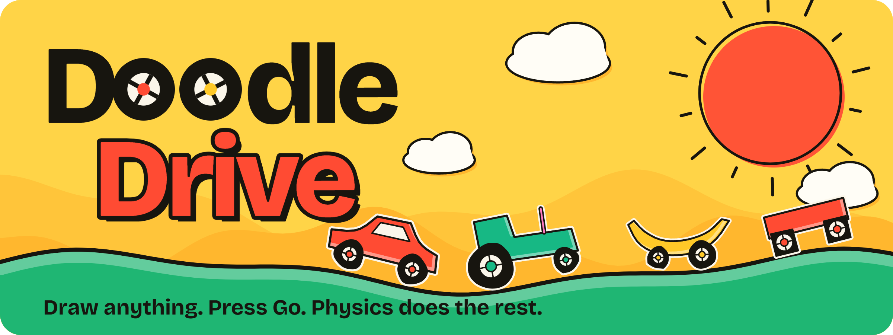</a>

<p align="center">
  <a href="https://pratyushshivam.github.io/doodle-drive/"></a>
  <a href="https://github.com/pratyushshivam/doodle-drive/actions/workflows/ci.yml"></a>
  <a href="LICENSE"></a>
  
</p>

<p align="center">
  <a href="https://pratyushshivam.github.io/doodle-drive/"><b>Play it</b></a> ·
  <a href="#how-a-doodle-becomes-a-machine">How it works</a> ·
  <a href="#the-courses">The courses</a> ·
  <a href="#run-it">Run it</a> ·
  <a href="https://www.pratyushshivam.com/">pratyushshivam.com</a>
</p>

# Doodle Drive

**Draw any vehicle with one finger. Press Go. Real physics does the rest.**

There is a sheet of paper and a big red button. Whatever you draw on the paper becomes solid. Anything round becomes a wheel with a motor in it. Then the paper flies away and your drawing has to cross a course of hills, steps, holes and wobbly planks to reach a flag.

Good drawings get there. Bad drawings are funnier. Square wheels work, slowly. A tall tower falls on its face. A brick with no wheels sits there and thinks about it. When it goes wrong you draw another one in five seconds.

**Play:** [pratyushshivam.github.io/doodle-drive](https://pratyushshivam.github.io/doodle-drive/)

<a href="https://pratyushshivam.github.io/doodle-drive/">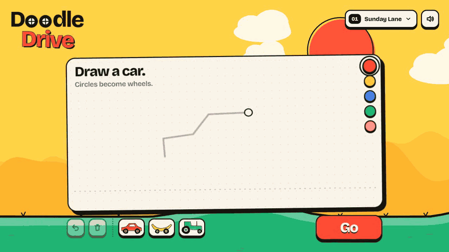</a>

<p align="center"><sub>One whole go, recorded from the running game. The drawing part is sped up.</sub></p>

No install, no account, no loading screen. It works with a mouse, a finger or a keyboard.

<table>
<tr>
<td width="50%" valign="top">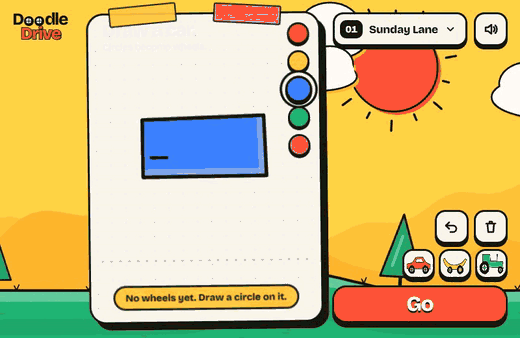<br><sub><b>Square wheels.</b> They do work. Nobody said smoothly.</sub></td>
<td width="50%" valign="top">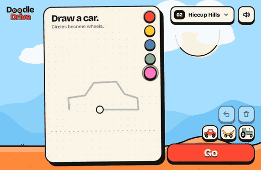<br><sub><b>A tower.</b> Tall things have opinions about hills.</sub></td>
</tr>
<tr>
<td width="50%" valign="top">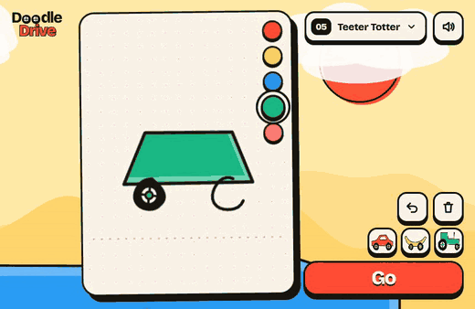<br><sub><b>Teeter Totter.</b> The plank tips when you do.</sub></td>
<td width="50%" valign="top">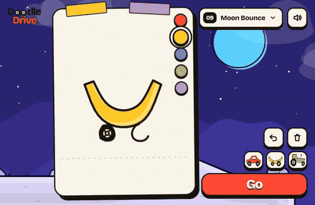<br><sub><b>A banana on the moon.</b> Low gravity is not kind to bananas.</sub></td>
</tr>
</table>

| | |
| :-- | :-- |
| **A go** | Ten to thirty seconds. Draw, hold, laugh, redraw |
| **The goal** | Reach the flag. Faster earns more stars, up to three per course |
| **Courses** | Ten, from a gentle lane to ice, low gravity and a bit of everything |
| **Controls** | Draw with a finger or mouse. Hold anywhere to go. The left edge is reverse |
| **Sharing** | A picture of your doodle with its time, made in the browser. Nothing is uploaded |
| **Stack** | TypeScript, one 2D canvas, [planck.js](https://github.com/piqnt/planck.js) for the physics, WebAudio for every sound. 67 kB of script, gzipped |

## How to play

1. **Draw a body.** Any closed shape. A car, a boot, a banana, a fish.
2. **Draw wheels.** Round shapes that touch the body become wheels. They spin on the paper so you can tell.
3. **Press Go and hold.** Hold anywhere on the screen to drive. Let go to coast.
4. **Stuck?** Tap Redraw. Your drawing is still on the paper, so fix it or start again.

A line that does not close becomes a stick: an aerial, a bumper, a very bad idea. A small shape drawn inside the body becomes a window. Tap any shape to flip it between body and wheel. If you would rather not draw, three ready-made doodles sit next to the Go button.

Keyboard: `→` `D` or `Space` to go, `←` or `A` to reverse, `R` to start the course again, `Esc` to go back to the paper, `Enter` to press Go, `Z` to undo.

<a href="https://pratyushshivam.github.io/doodle-drive/">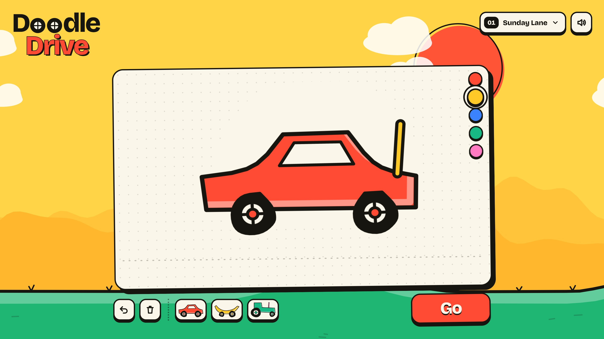</a>

<table>
<tr>
<td width="50%" valign="top">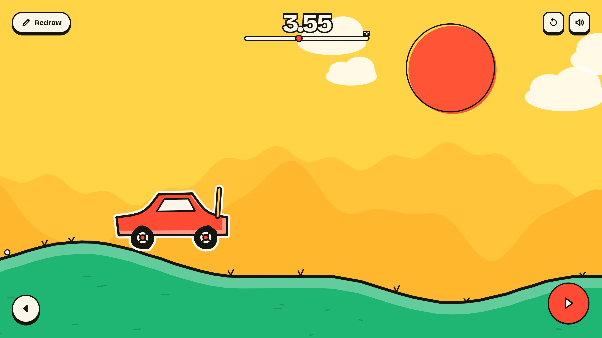<br><sub><b>Driving.</b> Hold to go. The timer starts on your first press.</sub></td>
<td width="50%" valign="top">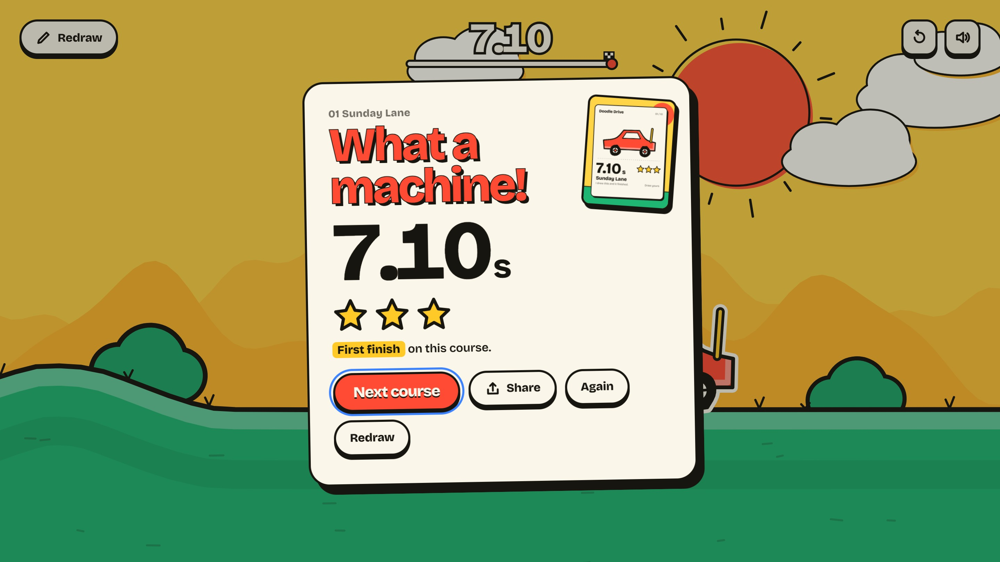<br><sub><b>The finish.</b> A time, up to three stars and a picture to share.</sub></td>
</tr>
</table>

## How a doodle becomes a machine

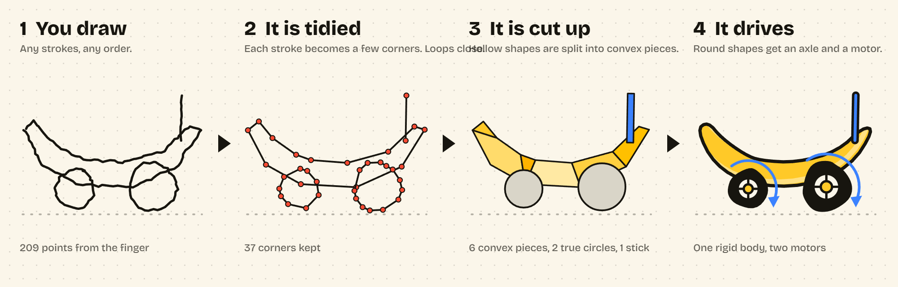

A physics engine wants neat convex shapes. A finger makes wobbly loops that overshoot, cross themselves and never quite close. Everything between the two is in [`src/engine/doodle.ts`](src/engine/doodle.ts) and [`src/engine/geom.ts`](src/engine/geom.ts), and none of it touches the screen, so it is tested on its own.

| Step | What happens | Where |
| :-- | :-- | :-- |
| **Even out** | The stroke is resampled so a fast hand and a slow hand give the same points | `resample` |
| **Close** | If the ends nearly meet, or the stroke crosses itself, the loop is kept and the tails are cut off | `readStroke`, `firstLoop` |
| **Tidy** | Ramer-Douglas-Peucker keeps only the corners that matter. A wobbly circle of sixty-odd points becomes a dozen or so | `simplifyRing` |
| **Decide** | The biggest shape is a body. A smaller, compact shape that touches a body is a wheel. A small shape inside a body is a window. An open line is a stick | `buildDoodle` |
| **Cut** | A hollow outline is split into convex pieces of at most eight corners. If the cut loses area, the hull is used instead | `convexPieces` |
| **Weld** | Bodies and sticks that touch become one rigid group. Pieces that touch nothing fall off, as they should | `buildDoodle` |
| **Mount** | Each wheel gets a sprung axle on the group it overlaps, and a motor. Nearly round wheels roll as true circles. Lumpy ones keep their lumps | [`sim.ts`](src/engine/sim.ts) |
| **Size** | The whole drawing is scaled to between 2.6 and 5.2 metres, so a tiny scribble and a full-page monster both fit the course | `buildDoodle` |

**Making almost anything drivable.** Motor strength is a share of the machine's own weight, so a heavy doodle is not weaker than a light one. Each wheel aims for the same road speed whatever its size. A little traction control eases the motor when the body rears up, measured against the hill it is on, and the motors ease off in the air so jumps do not end in a backflip. Axles are sprung, which soaks up kerbs and gives everything its wobble. None of this saves a truly bad idea. It only makes sure the bad idea fails in an entertaining way.

**What is real and what is not.** The rigid bodies, joints, friction and collisions are planck.js, a JavaScript port of Box2D, stepped at a fixed 60 times a second. The traction control, the air steadying and the size limits are game design, added so that a five-year-old's first car moves.

## The courses

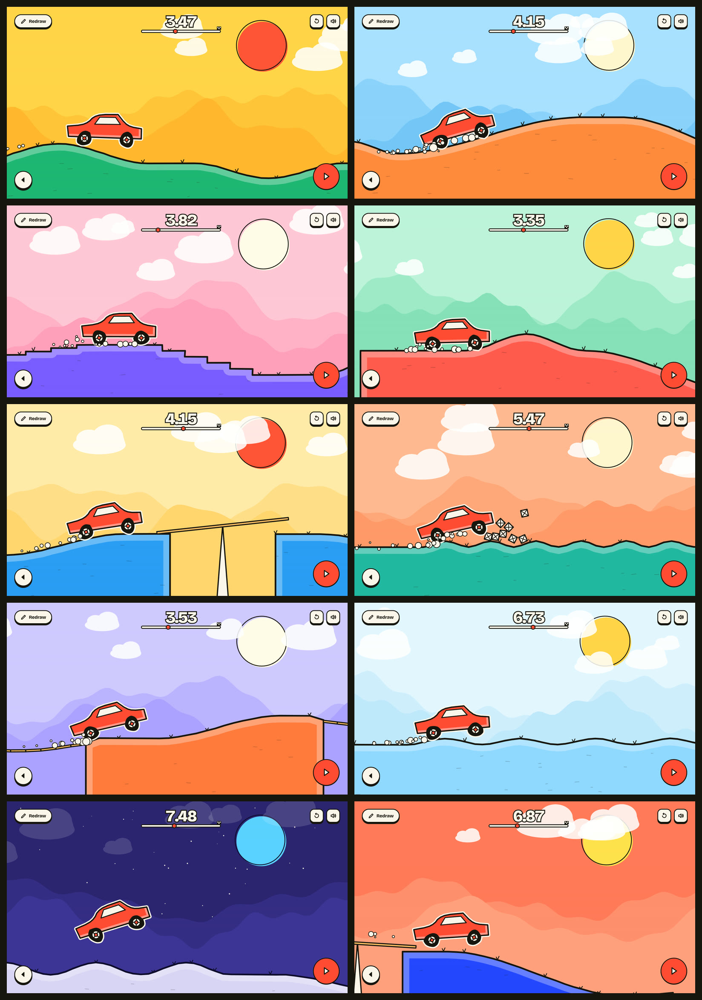

| | Course | The catch |
| :-- | :-- | :-- |
| 01 | **Sunday Lane** | A gentle roll to warm up |
| 02 | **Hiccup Hills** | Up, down, up, down, up |
| 03 | **The Staircase** | Small wheels will regret this |
| 04 | **Mind the Gap** | Speed is your friend |
| 05 | **Teeter Totter** | The plank tips when you do |
| 06 | **Washboard** | Ripples and a pile of crates |
| 07 | **Wobbly Bridge** | Do not look down |
| 08 | **Ice Rink** | Everything is slippery |
| 09 | **Moon Bounce** | Low gravity. Long, slow jumps |
| 10 | **The Big One** | A bit of everything |

Every course is a short recipe in [`src/engine/courses.ts`](src/engine/courses.ts), for example `b.hill(8, 0.9).flat(3).seesaw(6).flat(5)`. The tests drive each of them from start to flag with four different doodles, so a change to the physics cannot quietly make a course impossible.

## The share card

<table>
<tr>
<td width="34%" valign="top">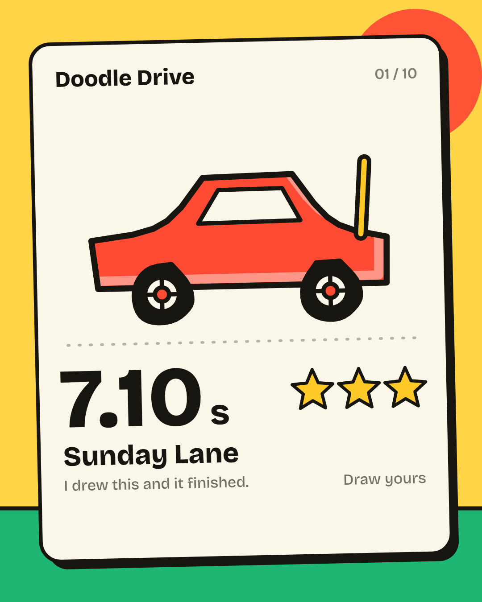</td>
<td width="66%" valign="top">

At the finish, and at a good flop, the game makes a picture: your doodle, the course, and either your time and stars or how far it got before it gave up.

It is drawn on a canvas in your browser. On a phone it goes to the system share sheet through the Web Share API. Anywhere else it is saved as a PNG. There is no server, no account and no tracking, and your best times live in `localStorage` on your own device.

</td>
</tr>
</table>

## On a phone

<table>
<tr>
<td width="33%" valign="top">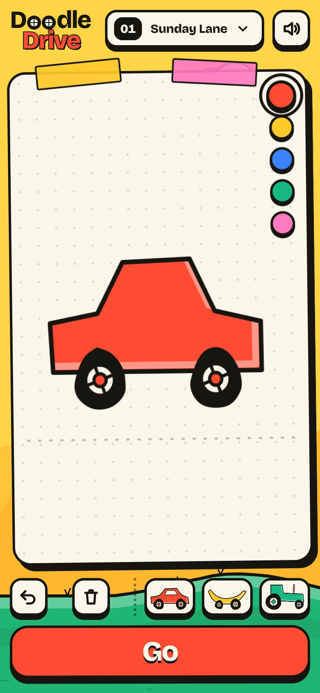</td>
<td width="33%" valign="top">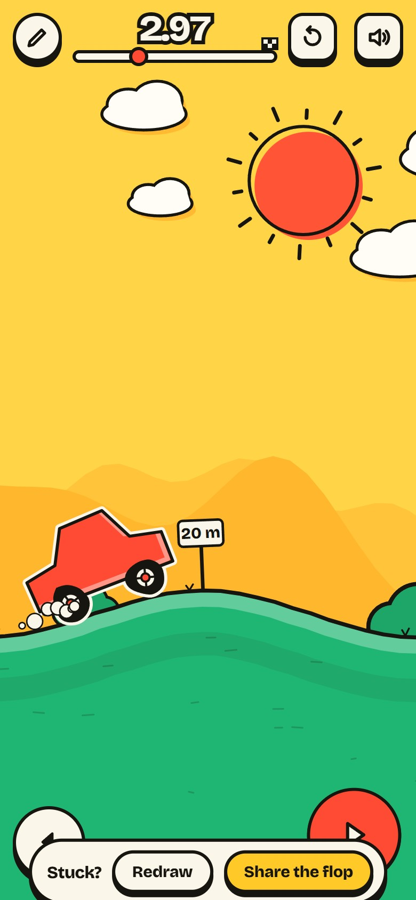</td>
<td width="33%" valign="top">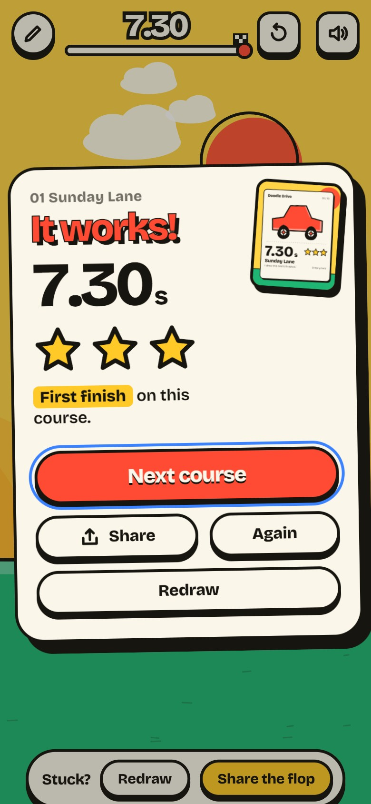</td>
</tr>
</table>

<p align="center"><sub>Portrait or on its side. Draw with a finger, hold anywhere to go.</sub></p>

## Run it

Needs Node.js 20 or newer.

```bash
npm install
```

```bash
npm run dev
```

Then open `http://localhost:5199`.

| Command | What it does |
| :-- | :-- |
| `npm run dev` | Development server |
| `npm run build` | Type check, then a static build in `dist/`, ready for any static host |
| `npm test` | Unit tests for the stroke reader and the cutter, and a full drive of every course |
| `npm run typecheck` | TypeScript, no emit |

The build uses relative paths, so the same `dist/` works at a domain root or in a sub-folder.

## How it is put together

```
src/engine   the model: geometry, stroke reading, courses, the physics world. No DOM. Tested.
src/game     the drawing pad, the world renderer, sound, the share card, saved progress
src/main.ts  the three screens (draw, drive, result) and the loop that ties them together
tests        what a doodle becomes, and that every course can be finished
```

The world is one 2D canvas, drawn in metres. Ink lines are traced twice with a slightly different wobble and swapped seven times a second, which is what makes them look hand-drawn. Every sound is an oscillator or a burst of noise built with WebAudio at the moment it is needed, so there are no audio files. The typeface is Bricolage Grotesque.

Every picture and recording on this page was captured from the running game. The doodles in them were drawn stroke by stroke through the real drawing pad.

## Licence

[MIT](LICENSE). Physics by [planck.js](https://github.com/piqnt/planck.js) (MIT). Convex decomposition by [poly-decomp-es](https://github.com/pmndrs/poly-decomp-es) (MIT). The Bricolage Grotesque typeface is used under the SIL Open Font License.

<p align="center"><sub>Built by <a href="https://www.pratyushshivam.com/">Pratyush Shivam</a>.</sub></p>
